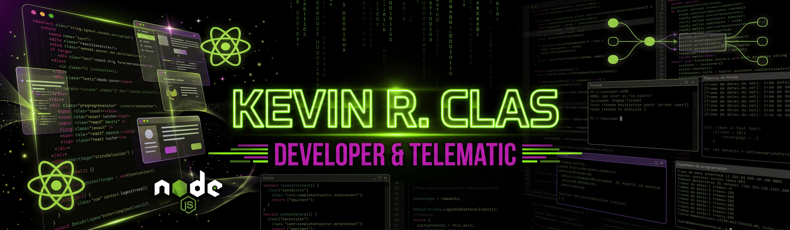

# Hola, soy Kevin Clas 👋

### Desarrollador Web & IoT | Entusiasta de Redes

---

### 🛠️ Tech Stack & Herramientas

**Desarrollo Web & Bases de Datos:**

**IoT, Hardware & Redes:**

---

### 📊 Mis Estadísticas en GitHub

  

---

### 📫 Conecta conmigo

&nbsp;&nbsp;
&nbsp;&nbsp;
&nbsp;&nbsp;

## 🚀 About Me
I'm a full stack developer...
